  

  <b>Homelabber &nbsp;·&nbsp; Hobby Developer &nbsp;·&nbsp; Open Source Enthusiast</b>

### A little about me

I enjoy tinkering with my homelab, building personal projects, and figuring out how things work. My interests range from self-hosted services and networking to automation and AI — with a soft spot for space and rocketry.

Most of my projects live in private repositories. This profile is a small window into what keeps me curious.

### In my orbit

| On Earth | Beyond the everyday |
| :--- | :--- |
| **Homelab & self-hosting** Running my own services and learning along the way. | **Automation & AI** Exploring ways to make everyday tasks simpler. |
| **Hobby development & open source** Building for fun and learning from the open-source community. | **Networking** Understanding how systems connect and communicate. |
| **Space & rocketry** Fascinated by launch vehicles, orbital mechanics, and exploration. | **Curiosity** Always another idea to try and something new to learn. |

### GitHub activity

  

  Based on contributions visible on my GitHub profile. Private projects aren't fully represented here.

---

  From a home server to low Earth orbit — there's always more to explore.

